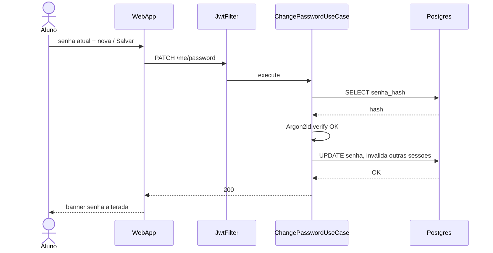

# F1.4-D03 — Trocar senha + invalidar outras sessões

| Campo | Valor |
|---|---|
| HU | US-F1-003 (HU-B) |
| Escopo | happy path — senha atual OK, nova forte, demais sessões caem |
| Atores | Aluno, WebApp, JwtFilter, ChangePasswordUseCase, Postgres |
| Pré-condições | `/perfil/seguranca`; senha atual conhecida; nova senha forte |
| Origem | `docs/tcc-docs.md` §8.2 · CA-03 · RN-F1.4-05 |

## Passos

1. Aluno envia senha atual + nova senha.
2. `PATCH /me/password` via JwtFilter → ChangePasswordUseCase.
3. Self-call Argon2id.verify(senhaAtual); se falhar → D04.
4. Hash da nova senha; invalida todos os refresh tokens **exceto** a sessão atual.
5. `200` → banner success.

## Mermaid

## Export

[`F1.4-D03-trocar-senha.puml`](./F1.4-D03-trocar-senha.puml)
