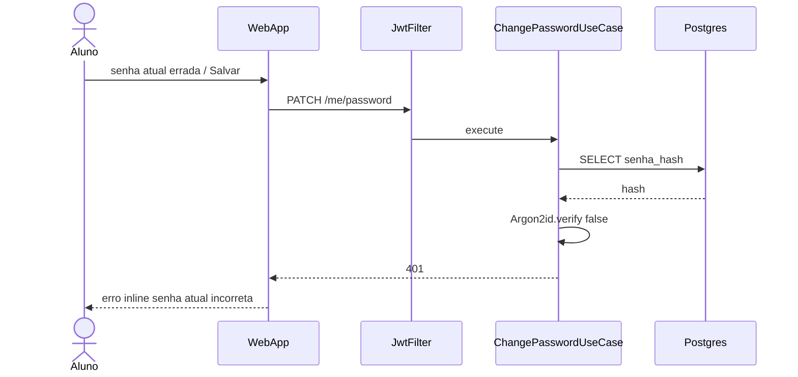

# F1.4-D04 — 401 senha atual incorreta

| Campo | Valor |
|---|---|
| HU | US-F1-003 (HU-B) |
| Escopo | Argon2id.verify falha na senha atual |
| Atores | Aluno, WebApp, JwtFilter, ChangePasswordUseCase, Postgres |
| Pré-condições | senha atual errada |
| Origem | `docs/tcc-docs.md` §8.2 · CA-03 · RN-F1.4-01 |

## Passos

1. `PATCH /me/password` com senha atual errada.
2. UseCase: Argon2id.verify = false → ROLLBACK.
3. `401` Problem Details (`senha_atual_incorreta`).
4. WebApp: erro inline “Senha atual incorreta.”

## Mermaid

## Export

[`F1.4-D04-senha-atual-incorreta.puml`](./F1.4-D04-senha-atual-incorreta.puml)
