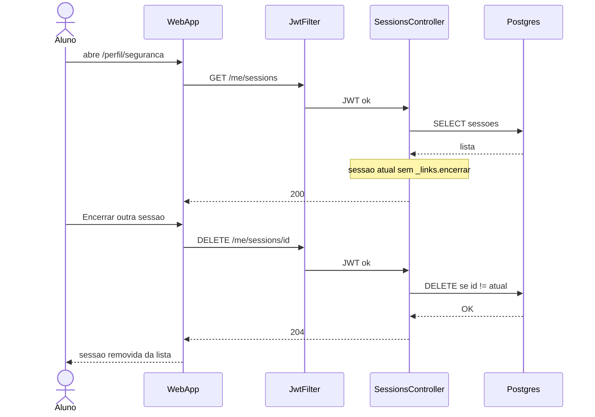

# F1.4-D05 — Listar sessões + encerrar outra (HATEOAS)

| Campo | Valor |
|---|---|
| HU | US-F1-003 (HU-B) |
| Escopo | load das sessões + `DELETE` via `_links.encerrar` |
| Atores | Aluno, WebApp, JwtFilter, SessionsController, Postgres |
| Pré-condições | `/perfil/seguranca`; há sessão em outro dispositivo |
| Origem | `docs/tcc-docs.md` §8.2 · CA-04 · RN-F1.4-03/04 |

## Passos

1. WebApp → `GET /me/sessions` (sessão atual **sem** `_links.encerrar`).
2. Aluno clica **Encerrar** na sessão remota (só se o link existir).
3. `DELETE /me/sessions/{id}` com guard `id != currentSessionId`.
4. Refresh token do outro device fica inválido; some da lista.

## Mermaid

## Export

[`F1.4-D05-sessoes.puml`](./F1.4-D05-sessoes.puml)
