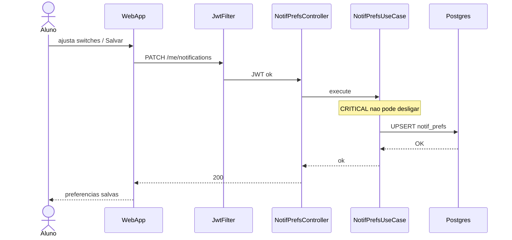

# F1.5-D06 — Salvar preferências de notificação

| Campo | Valor |
|---|---|
| HU | US-F1-003 (HU-C) |
| Escopo | matriz de canais, DND e digest (`PATCH /me/notifications`) |
| Atores | Aluno, WebApp, JwtFilter, NotifPrefsController, NotifPrefsUseCase, Postgres |
| Pré-condições | `/perfil/notificacoes`; alterou switch não-CRITICAL |
| Origem | `docs/tcc-docs.md` §8.2 · CA-05 · RN-F1.5-01/03/04 |

## Passos

1. Aluno ajusta preferências e salva.
2. `PATCH /me/notifications` via JwtFilter.
3. UseCase revalida: CRITICAL não pode ser desabilitado (mesmo se o front já bloqueia).
4. UPSERT no Postgres (canais + DND + digest).
5. `200` → efeito na próxima entrega do Outbox.

## Mermaid

## Export

[`F1.5-D06-preferencias-notif.puml`](./F1.5-D06-preferencias-notif.puml)
