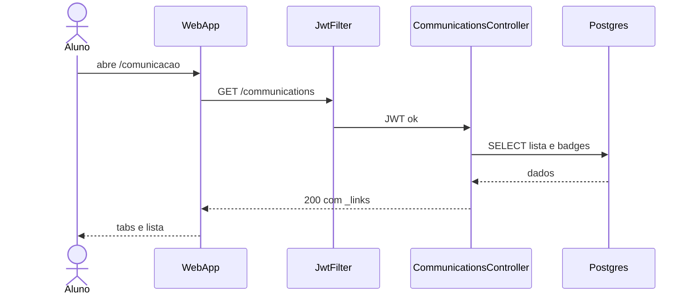

# F1.6-D01 — Listagem de comunicações

| Campo | Valor |
|---|---|
| HU | US-F1-004 |
| Escopo | happy path — `/comunicacao` com tabs e badges |
| Atores | Aluno, WebApp, JwtFilter, CommunicationsController, Postgres |
| Pré-condições | `communication.read`; há comunicação entregue |
| Origem | `docs/tcc-docs.md` §8.2 · CA-01 · RN-F1.6-04/06 |

## Passos

1. Aluno abre `/comunicacao` (skeleton).
2. `GET /communications` via JwtFilter.
3. Backend resolve lista + contagens de não lidos numa só query.
4. `200` + `_links` (`marcar-lido`, CTAs da Inbox via `useActions`).

## Mermaid

## Export

[`F1.6-D01-listar-comunicacoes.puml`](./F1.6-D01-listar-comunicacoes.puml)
