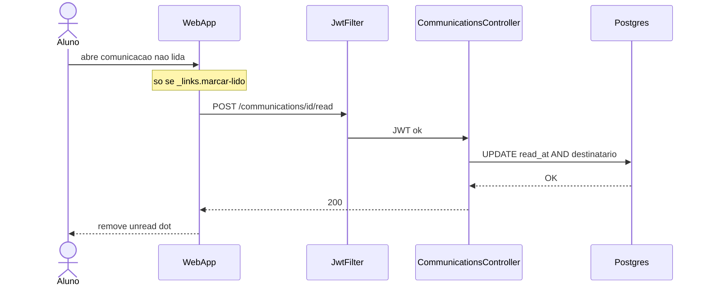

# F1.6-D02 — Marcar comunicação como lida

| Campo | Valor |
|---|---|
| HU | US-F1-004 |
| Escopo | clique dispara `POST` só se `_links.marcar-lido` existir |
| Atores | Aluno, WebApp, JwtFilter, CommunicationsController, Postgres |
| Pré-condições | lista carregada; `read_at` null; link presente |
| Origem | `docs/tcc-docs.md` §8.2 · CA-02 · RN-F1.6-03 |

## Passos

1. Aluno abre comunicação não lida.
2. Se `_links.marcar-lido` existe → `POST /communications/:id/read`.
3. Postgres: `UPDATE` com `destinatario_id = aluno` (anti-IDOR).
4. Unread dot some (pode ser otimista no cliente).

## Mermaid

## Export

[`F1.6-D02-marcar-lido.puml`](./F1.6-D02-marcar-lido.puml)
