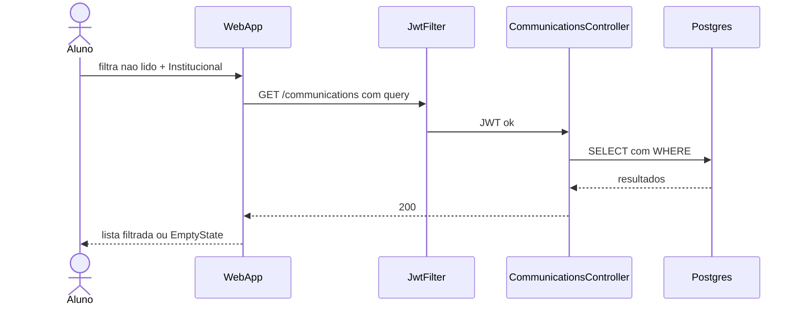

# F1.6-D03 — Filtros no backend (query params)

| Campo | Valor |
|---|---|
| HU | US-F1-004 |
| Escopo | filtros no servidor; front não filtra array local |
| Atores | Aluno, WebApp, JwtFilter, CommunicationsController, Postgres |
| Pré-condições | `/comunicacao`; escolhe “Não lido” + “Institucional” |
| Origem | `docs/tcc-docs.md` §8.2 · CA-04 · RN-F1.6-04 |

## Passos

1. Aluno aplica filtros.
2. `GET /communications?lido=false&tipo=INSTITUCIONAL` (+ page/size).
3. Postgres aplica `WHERE` composto.
4. Lista filtrada ou EmptyState se vazio.

## Mermaid

## Export

[`F1.6-D03-filtros-comunicacoes.puml`](./F1.6-D03-filtros-comunicacoes.puml)
