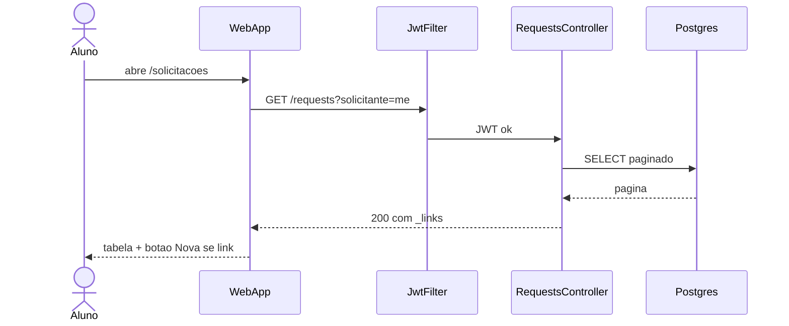

# F1.7-D01 — Listar solicitações paginadas

| Campo | Valor |
|---|---|
| HU | US-F1-005 (HU-A) |
| Escopo | `/solicitacoes` com filtros opcionais |
| Atores | Aluno, WebApp, JwtFilter, RequestsController, Postgres |
| Pré-condições | `request.view_own` |
| Origem | `docs/tcc-docs.md` §8.2 · CA-01 · RN-F1.7-01 |

## Passos

1. Aluno abre `/solicitacoes`.
2. `GET /requests?solicitante=me` (+ filtros estado/tipo/ano).
3. `200` + `_links.novaSolicitacao` só se `request.open`.

## Mermaid

## Export

[`F1.7-D01-listar-solicitacoes.puml`](./F1.7-D01-listar-solicitacoes.puml)
