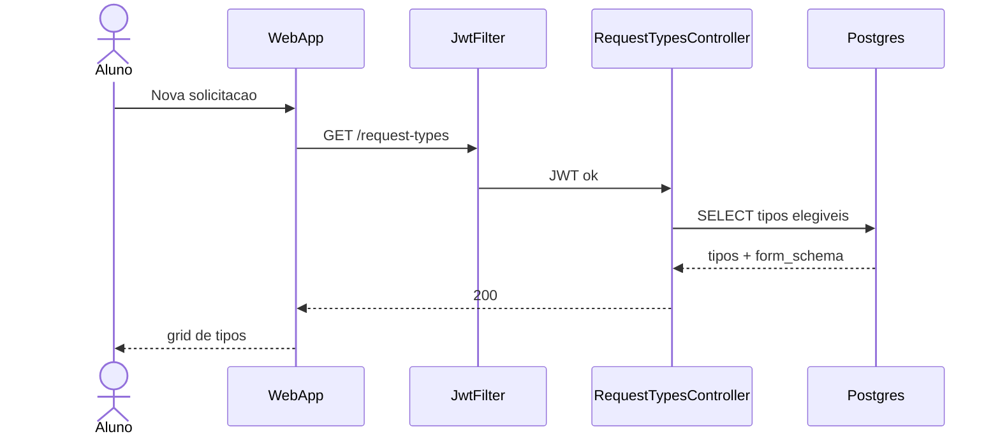

# F1.8-D02 — Wizard passo 1: tipos elegíveis

| Campo | Valor |
|---|---|
| HU | US-F1-005 (HU-B) |
| Escopo | backend filtra tipos por curso/período/pré-requisitos |
| Atores | Aluno, WebApp, JwtFilter, RequestTypesController, Postgres |
| Pré-condições | clicou “Nova” via `_links.novaSolicitacao` |
| Origem | `docs/tcc-docs.md` §8.2 · CA-02 · RN-F1.8-02 |

## Passos

1. Aluno entra em `/solicitacoes/nova`.
2. `GET /request-types` — só tipos elegíveis (não elegíveis nem vêm na resposta).
3. `form_schema` já vem junto para o passo 2 (cache TanStack).

## Mermaid

## Export

[`F1.8-D02-tipos-elegiveis.puml`](./F1.8-D02-tipos-elegiveis.puml)
