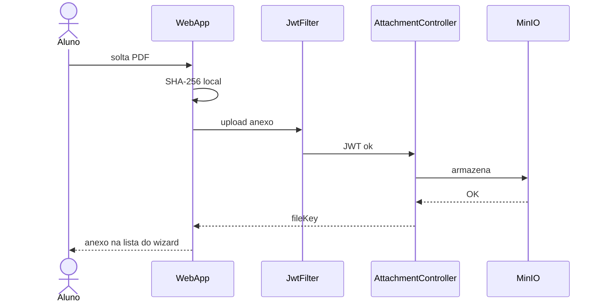

# F1.8-D03 — Upload de anexo no wizard

| Campo | Valor |
|---|---|
| HU | US-F1-005 (HU-B) |
| Escopo | SHA-256 local + upload |
| Atores | Aluno, WebApp, JwtFilter, AttachmentController, MinIO |
| Pré-condições | passo 2; arquivo ≤ 10 MB |
| Origem | `docs/tcc-docs.md` §8.2 · CA-04 · RN-F1.8-04 |

## Passos

1. Browser calcula SHA-256 localmente (sem HTTP).
2. Upload via AttachmentController → MinIO.
3. `fileKey` fica no estado do wizard para o `POST /requests` (D04).

> No `tcc-docs.md` este upload está **fora da demonstração (4.11)** — anotação de escopo para o time, não legenda da figura.

## Mermaid

## Export

[`F1.8-D03-upload-anexo.puml`](./F1.8-D03-upload-anexo.puml)
