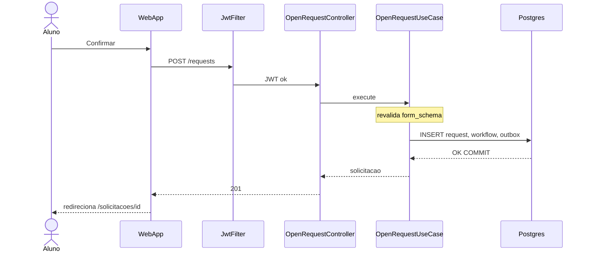

# F1.8-D04 — Confirmar wizard (`POST /requests`)

| Campo | Valor |
|---|---|
| HU | US-F1-005 (HU-B) |
| Escopo | cria solicitação + prazo + outbox na mesma TX |
| Atores | Aluno, WebApp, JwtFilter, OpenRequestController, OpenRequestUseCase, Postgres |
| Pré-condições | passos 1–2 ok; form validado |
| Origem | `docs/tcc-docs.md` §8.2 · CA-05 · RN-F1.8-03/06/07 |

## Passos

1. Aluno confirma no passo 3.
2. UseCase revalida contra `form_schema` (não confia só no Zod).
3. Gera `numero_anual`, calcula `prazo_em`, inicia workflow.
4. `INSERT` solicitação + `outbox_event` (mesma TX).
5. `201/200` → redireciona `/solicitacoes/:id`.

## Mermaid

## Export

[`F1.8-D04-confirmar-wizard.puml`](./F1.8-D04-confirmar-wizard.puml)
