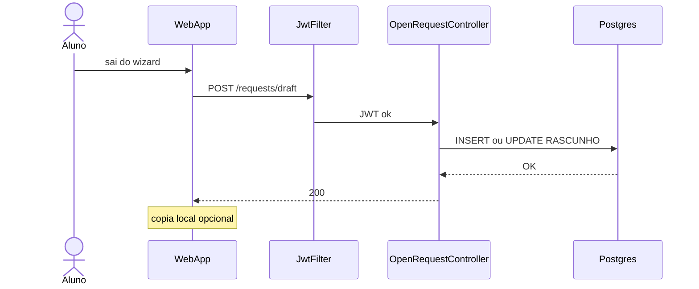

# F1.8-D05 — Salvar rascunho (`POST /requests/draft`)

| Campo | Valor |
|---|---|
| HU | US-F1-005 (HU-B) |
| Escopo | dados parciais persistidos como `RASCUNHO` |
| Atores | Aluno, WebApp, JwtFilter, OpenRequestController, Postgres |
| Pré-condições | passo 2 parcial; sai da tela / fecha aba |
| Origem | `docs/tcc-docs.md` §8.2 · CA-06 · RN-F1.8-05 |

## Passos

1. Aluno abandona o wizard com dados parciais.
2. WebApp → `POST /requests/draft`.
3. Postgres persiste estado `RASCUNHO`.
4. Também pode haver cópia local (PWA); ao voltar, modal “Continuar ou novo?” é só no cliente.

## Mermaid

## Export

[`F1.8-D05-rascunho.puml`](./F1.8-D05-rascunho.puml)
