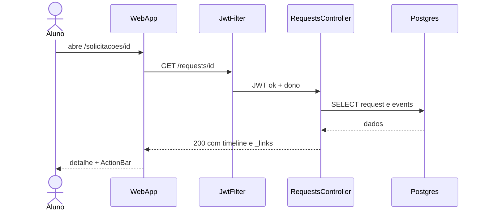

# F1.9-D06 — Detalhe com timeline e HATEOAS

| Campo | Valor |
|---|---|
| HU | US-F1-005 (HU-C) |
| Escopo | `GET /requests/{id}` + timeline + ActionBar por `_links` |
| Atores | Aluno, WebApp, JwtFilter, RequestsController, Postgres |
| Pré-condições | `request.view_own`; solicitação do próprio aluno |
| Origem | `docs/tcc-docs.md` §8.2 · CA-07 · RN-F1.9-01/04 |

## Passos

1. Aluno abre `/solicitacoes/:id`.
2. Guard de dono (anti-IDOR) + `SELECT` solicitação + eventos `ORDER BY created_at DESC`.
3. ActionBar 100% via `_links` (`editar`, `gerar-protocolo`, …).

## Mermaid

## Export

[`F1.9-D06-detalhe-solicitacao.puml`](./F1.9-D06-detalhe-solicitacao.puml)
