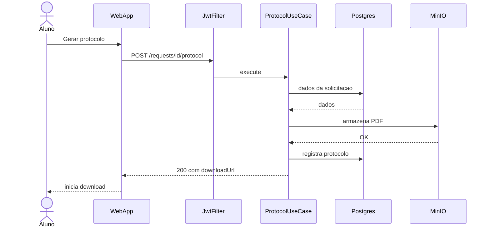

# F1.9-D07 — Gerar protocolo PDF com QR

| Campo | Valor |
|---|---|
| HU | US-F1-005 (HU-C) |
| Escopo | `POST /requests/{id}/protocol` → PDF + URL de download |
| Atores | Aluno, WebApp, JwtFilter, ProtocolUseCase, Postgres, MinIO |
| Pré-condições | estado `DELIBERADA`; `_links.gerar-protocolo` presente |
| Origem | `docs/tcc-docs.md` §8.2 · RN-F1.9-03 |

## Passos

1. Aluno clica **Gerar protocolo**.
2. UseCase gera PDF (com QR para F0.6), grava no MinIO, registra no Postgres.
3. Retorna URL pré-assinada (TTL 15 min); browser baixa direto.

## Mermaid

## Export

[`F1.9-D07-gerar-protocolo.puml`](./F1.9-D07-gerar-protocolo.puml)
