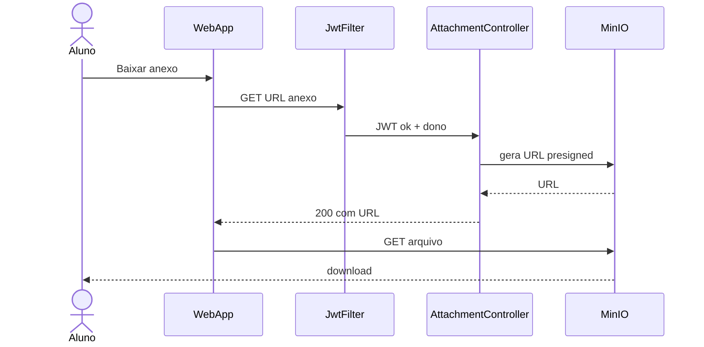

# F1.9-D08 — Download de anexo (URL pré-assinada)

| Campo | Valor |
|---|---|
| HU | US-F1-005 (HU-C) |
| Escopo | bytes vão direto do MinIO; TTL 15 min |
| Atores | Aluno, WebApp, JwtFilter, AttachmentController, MinIO |
| Pré-condições | detalhe carregado (D06); anexo na lista |
| Origem | `docs/tcc-docs.md` §8.2 · RN-F1.9-05 |

## Passos

1. Aluno pede download do anexo.
2. AttachmentController checa dono e emite URL pré-assinada GET.
3. Browser baixa do MinIO (sem trafegar bytes pelo backend).

## Mermaid

## Export

[`F1.9-D08-download-anexo.puml`](./F1.9-D08-download-anexo.puml)
