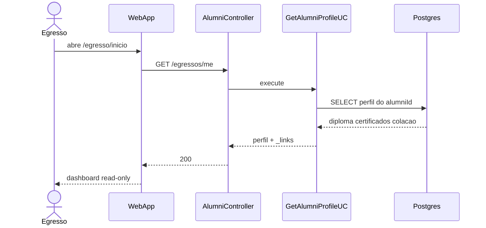

# F2.1-D01 — Dashboard do egresso (read-only)

| Campo | Valor |
|---|---|
| HU | US-F2-001 |
| Escopo | happy path — `GET /egressos/me` → painel só leitura |
| Atores | Egresso, WebApp, AlumniController, GetAlumniProfileUC, Postgres |
| Pré-condições | JWT com `alumni.view_own`; diploma registrado |
| Origem | `docs/tcc-docs.md` §8.3 · CA-01/02 · RN-F2.1-04/06/09 |

## Passos

1. Egresso acessa `/egresso/inicio`.
2. `GET /egressos/me` (escopo só do próprio alumniId).
3. Resposta com diploma, certificados, colação + `_links.download` / `_links.reemitir`.
4. UI read-only via `useActions` — sem CTAs de criação.

## Mermaid

## Export

[`F2.1-D01-dashboard-egresso.puml`](./F2.1-D01-dashboard-egresso.puml)
