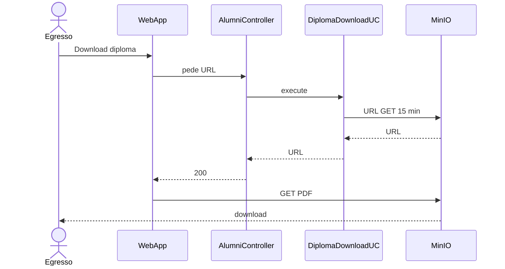

# F2.1-D02 — Download do diploma

| Campo | Valor |
|---|---|
| HU | US-F2-001 |
| Escopo | URL pré-assinada do PDF oficial; sem regenerar artefato |
| Atores | Egresso, WebApp, AlumniController, DiplomaDownloadUC, MinIO |
| Pré-condições | `_links.download` presente; PDF já no MinIO (secretaria) |
| Origem | `docs/tcc-docs.md` §8.3 · CA-02 · RN-F2.1-10 |

## Passos

1. Egresso clica Download do diploma.
2. UseCase gera URL GET temporária (TTL 15 min) no MinIO.
3. Browser baixa o PDF institucional (não é reassinado como certificado).

## Mermaid

## Export

[`F2.1-D02-download-diploma.puml`](./F2.1-D02-download-diploma.puml)
