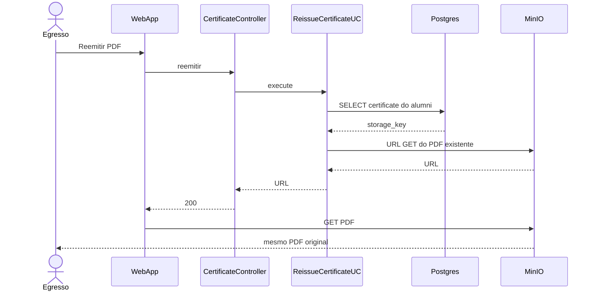

# F2.1-D03 — Reemitir certificado

| Campo | Valor |
|---|---|
| HU | US-F2-001 |
| Escopo | mesma URL do artefato existente — sem novo hash/assinatura |
| Atores | Egresso, WebApp, CertificateController, ReissueCertificateUC, Postgres, MinIO |
| Pré-condições | `_links.reemitir`; certificado EMITIDO no MinIO |
| Origem | `docs/tcc-docs.md` §8.3 · CA-03 · RN-F2.1-06..08 |

## Passos

1. Egresso clica **Reemitir PDF**.
2. UseCase confirma dono + `storage_key`; gera URL pré-assinada do arquivo **já existente**.
3. Sem INSERT de certificado; hash e ED25519 continuam os originais; ainda verificável em F0.7.

## Mermaid

## Export

[`F2.1-D03-reemitir-certificado.puml`](./F2.1-D03-reemitir-certificado.puml)
