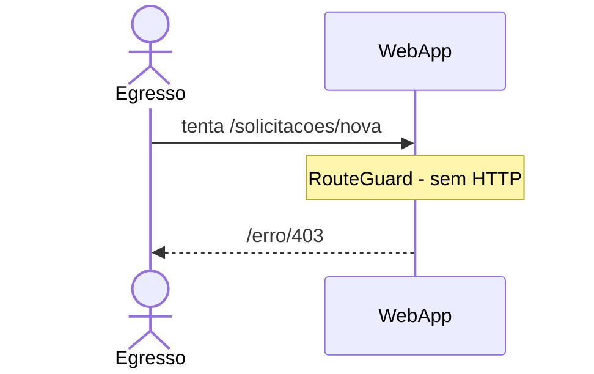

# F2.1-D04 — 403 rota exclusiva de aluno

| Campo | Valor |
|---|---|
| HU | US-F2-001 |
| Escopo | RouteGuard bloqueia no front; sem chamada à API |
| Atores | Egresso, WebApp |
| Pré-condições | JWT com `alumni.view_own`; sem `request.open` etc. |
| Origem | `docs/tcc-docs.md` §8.3 · CA-04 · RN-F2.1-02/04 |

## Passos

1. Egresso tenta `/solicitacoes/nova` (ou outra rota de aluno).
2. Guard lê authorities/`_links` em memória — **sem HTTP**.
3. Vai para `/erro/403`; “Ir ao início” → `/egresso/inicio`.

> Bypass direto na API ainda cairia em `@PreAuthorize` 403 (coberto em F0.5-b).

## Mermaid

## Export

[`F2.1-D04-bloqueio-rota-aluno.puml`](./F2.1-D04-bloqueio-rota-aluno.puml)
