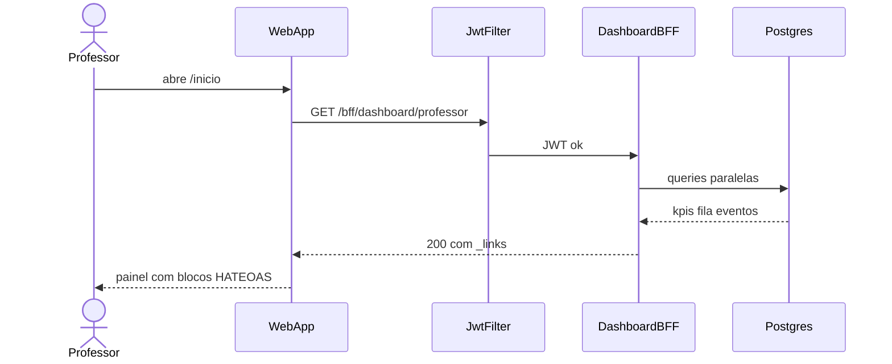

# F3.1-D01 — Dashboard do professor (cache MISS)

| Campo | Valor |
|---|---|
| HU | US-F3-001 |
| Escopo | happy path — `GET /bff/dashboard/professor` |
| Atores | Professor, WebApp, JwtFilter, DashboardBFF, Postgres |
| Pré-condições | `dashboard.view_self_professor`; token válido |
| Origem | `docs/tcc-docs.md` §8.4 · CA-01..03 |

## Passos

1. Professor abre `/inicio`.
2. BFF agrega KPIs, fila (`canDeliberate`), eventos; formativas CAAF só se `formative.review`.
3. CTAs via `_links` (`operar`, etc.).

## Mermaid

## Export

[`F3.1-D01-dashboard-professor.puml`](./F3.1-D01-dashboard-professor.puml)
