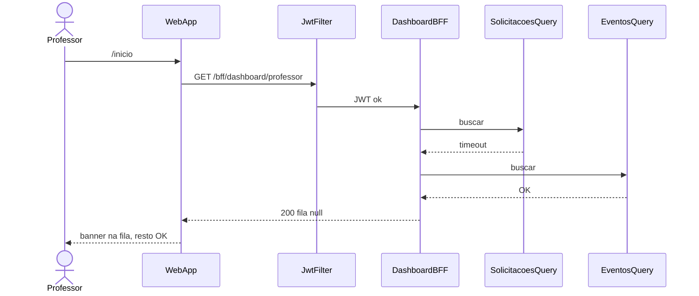

# F3.1-D02 — Degradação graciosa (solicitações indisponíveis)

| Campo | Valor |
|---|---|
| HU | US-F3-001 |
| Escopo | BFF 200 parcial; bloco de fila com banner |
| Atores | Professor, WebApp, JwtFilter, DashboardBFF, SolicitacoesQuery, EventosQuery |
| Pré-condições | solicitações timeout/503; eventos OK |
| Origem | `docs/tcc-docs.md` §8.4 · CA-04 · RN-F3.1-06 |

## Passos

1. `GET /bff/dashboard/professor`.
2. `SolicitacoesQuery` falha; `EventosQuery` OK.
3. Resposta `200` com `filaSolicitacoes: null` → AlertBanner; demais blocos normais.

## Mermaid

## Export

[`F3.1-D02-degradacao-graciosa.puml`](./F3.1-D02-degradacao-graciosa.puml)
