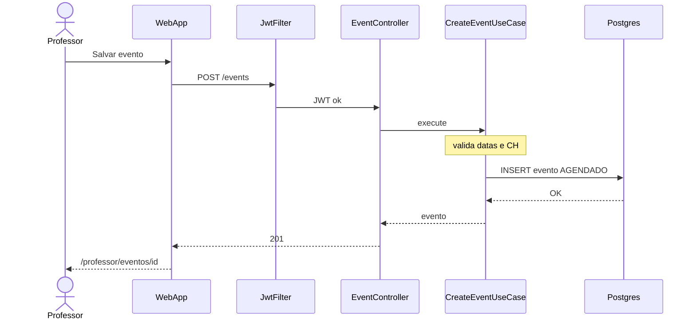

# F3.2-D01 — Criar evento

| Campo | Valor |
|---|---|
| HU | US-F3-002 |
| Escopo | happy path — `POST /events` → AGENDADO |
| Atores | Professor, WebApp, JwtFilter, EventController, CreateEventUseCase, Postgres |
| Pré-condições | `event.manage`; `_links.novoEvento` |
| Origem | `docs/tcc-docs.md` §8.4 · CA-01 · RN-F3.2-07 |

## Passos

1. Professor salva o formulário.
2. UseCase valida datas/CH/janelas; INSERT evento.
3. `201` → detalhe; `_links.excluir` presente em AGENDADO.

## Mermaid

## Export

[`F3.2-D01-criar-evento.puml`](./F3.2-D01-criar-evento.puml)
