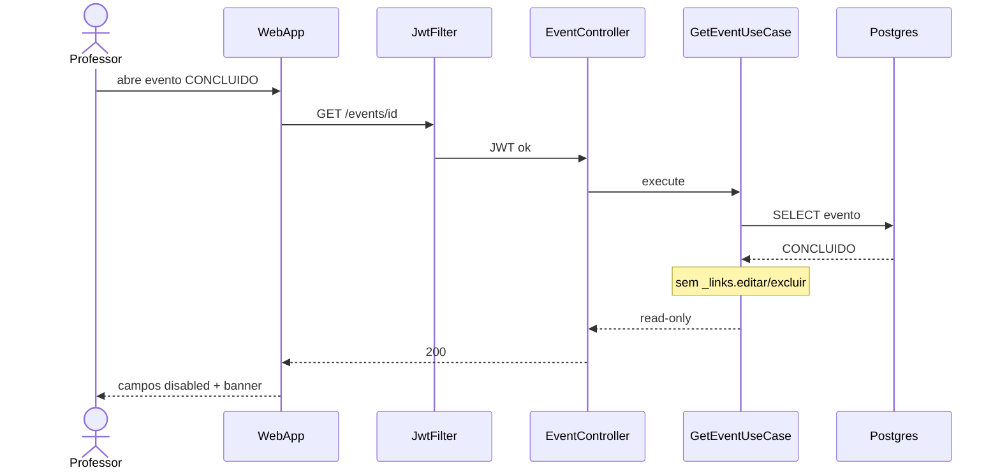

# F3.2-D02 — Detalhe evento CONCLUIDO

| Campo | Valor |
|---|---|
| HU | US-F3-002 |
| Escopo | imutável; sem `_links.editar` / `excluir` |
| Atores | Professor, WebApp, JwtFilter, EventController, GetEventUseCase, Postgres |
| Pré-condições | evento `CONCLUIDO` |
| Origem | `docs/tcc-docs.md` §8.4 · CA-03 · RN-F3.2-05/06 |

## Passos

1. `GET /events/{id}`.
2. Assembler omite links de edição/exclusão.
3. UI read-only + banner “somente leitura”.

## Mermaid

## Export

[`F3.2-D02-evento-concluido.puml`](./F3.2-D02-evento-concluido.puml)
