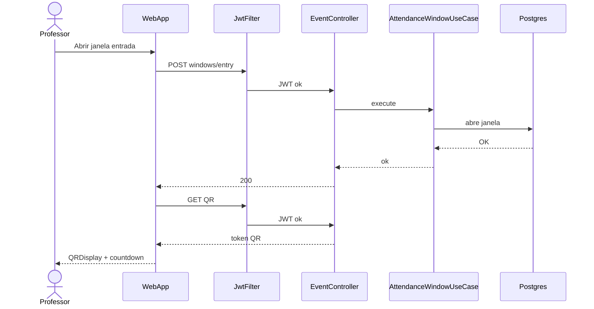

# F3.2-D03 — Painel operação QR_SINGLE

| Campo | Valor |
|---|---|
| HU | US-F3-002 |
| Escopo | abrir janela + obter QR + polling de contadores |
| Atores | Professor, WebApp, JwtFilter, EventController, AttendanceWindowUseCase, Postgres |
| Pré-condições | `event.host`; EM_ANDAMENTO; `_links.abrir-janela-entrada` |
| Origem | `docs/tcc-docs.md` §8.4 · CA-04 · RN-F3.2-09/11/12 |

## Passos

1. Professor abre janela de entrada.
2. `POST .../windows/entry` → depois GET do QR.
3. UI exibe QR + countdown; polling renova QR (~5 min) e contadores (~5 s).

## Mermaid

## Export

[`F3.2-D03-operacao-qr.puml`](./F3.2-D03-operacao-qr.puml)
