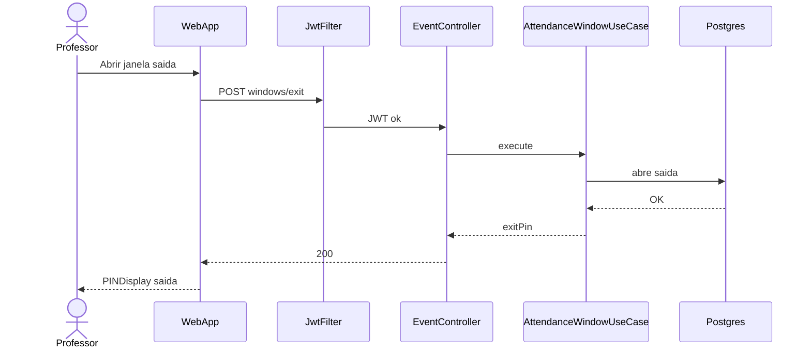

# F3.2-D04 — Painel operação SECRET_DUAL (janela saída)

| Campo | Valor |
|---|---|
| HU | US-F3-002 |
| Escopo | abrir fase de saída + exibir PIN |
| Atores | Professor, WebApp, JwtFilter, EventController, AttendanceWindowUseCase, Postgres |
| Pré-condições | entrada concluída; `_links.abrir-janela-saida` |
| Origem | `docs/tcc-docs.md` §8.4 · CA-05 · RN-F3.2-10 |

## Passos

1. Professor abre janela de saída.
2. UseCase exige entrada concluída; marca inelegíveis quem não entrou.
3. UI: PINDisplay com PIN de saída.

## Mermaid

## Export

[`F3.2-D04-operacao-pin-saida.puml`](./F3.2-D04-operacao-pin-saida.puml)
