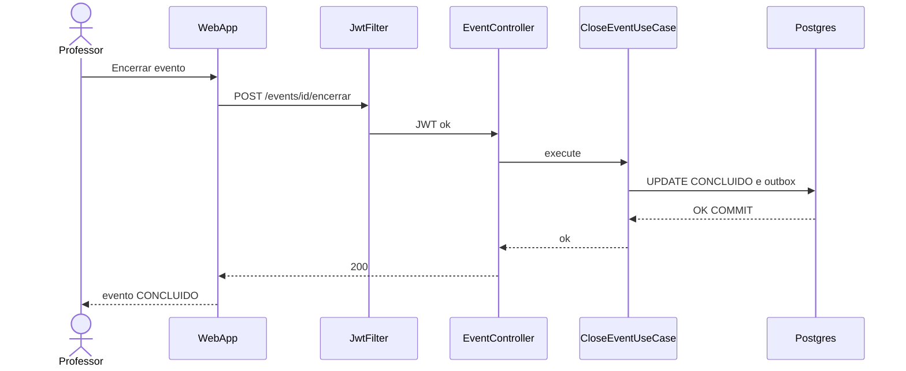

# F3.2-D05 — Encerrar evento

| Campo | Valor |
|---|---|
| HU | US-F3-002 |
| Escopo | `CONCLUIDO` + outbox para emissão de certificados |
| Atores | Professor, WebApp, JwtFilter, EventController, CloseEventUseCase, Postgres |
| Pré-condições | EM_ANDAMENTO; `_links.encerrar-evento` |
| Origem | `docs/tcc-docs.md` §8.4 · CA-07 |

## Passos

1. Professor confirma encerramento.
2. TX: estado `CONCLUIDO` + `outbox_event` (`events.closed`).
3. Dispatcher (fora deste diagrama) emite certificados dos presentes.

## Mermaid

## Export

[`F3.2-D05-encerrar-evento.puml`](./F3.2-D05-encerrar-evento.puml)
