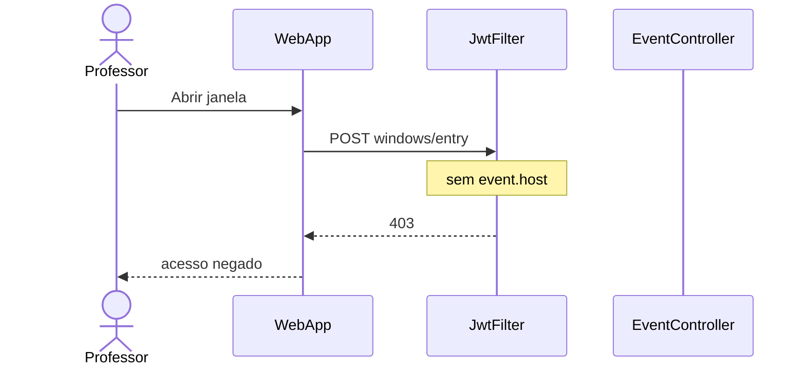

# F3.2-ERRO — 403 sem event.host

| Campo | Valor |
|---|---|
| HU | US-F3-002 |
| Escopo | tentativa de operar janela sem `event.host` |
| Atores | Professor, WebApp, JwtFilter, EventController |
| Pré-condições | JWT válido; `event.host` ausente |
| Origem | `docs/tcc-docs.md` §8.4 · RN-F3.2-08 |

## Passos

1. POST de janela (UI normalmente não chega aqui — HATEOAS).
2. JwtFilter / controller → `403`.

## Mermaid

## Export

[`F3.2-ERRO-sem-event-host.puml`](./F3.2-ERRO-sem-event-host.puml)
