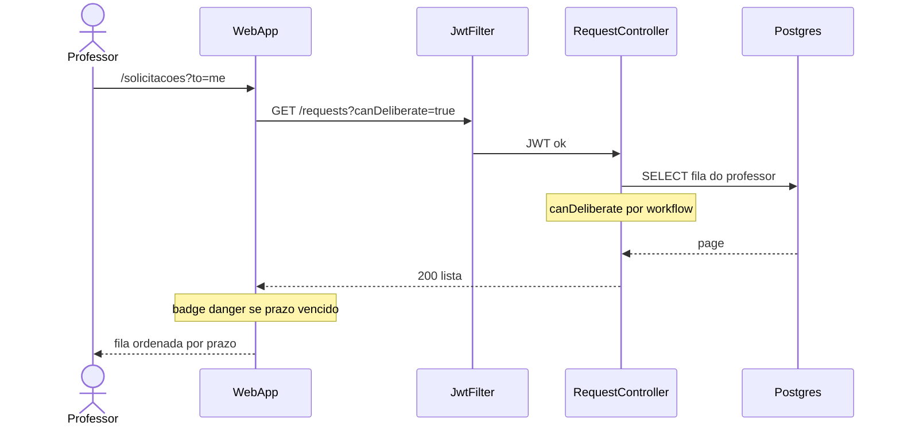

# F3.3-D01 — Fila de deliberação

| Campo | Valor |
|---|---|
| HU | US-F3-003 |
| Escopo | `GET /requests?canDeliberate=true` — fila do professor |
| Atores | Professor, WebApp, JwtFilter, RequestController, Postgres |
| Pré-condições | autenticado com `request.deliberate` |
| Origem | `docs/tcc-docs.md` §8.4 · CA-01 · RN-F3.3-01 |

## Passos

1. Professor abre `/solicitacoes?to=me`.
2. Backend filtra por `canDeliberate` (workflow + `requiresAuthority` × authorities).
3. Frontend marca prazo vencido (`prazo_em < now`) com badge danger — sem HTTP extra.
4. Clique na linha → `/solicitacoes/:id/deliberar` (GET detalhe + `_links` — padrão F3.4-D02).

## Mermaid

## Export

[`F3.3-D01-fila-deliberacao.puml`](./F3.3-D01-fila-deliberacao.puml)
