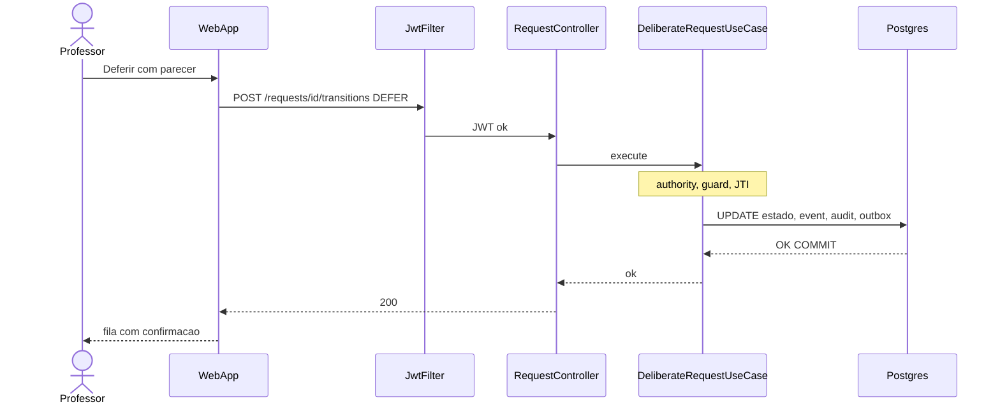

# F3.4-D02 — Deferir solicitação

| Campo | Valor |
|---|---|
| HU | US-F3-003 |
| Escopo | `POST /transitions` DEFER + TX atômica + outbox |
| Atores | Professor, WebApp, JwtFilter, RequestController, DeliberateRequestUseCase, Postgres |
| Pré-condições | `request.deliberate`; `_links.deferir`; parecer preenchido |
| Origem | `docs/tcc-docs.md` §8.4 · CA-03 · RN-F3.4-05 |

## Passos

1. Professor preenche parecer e clica Deferir.
2. UseCase valida authority × transição, guard do workflow e JTI (se deep-link).
3. TX: UPDATE estado + `request_event` + `audit_log` + `outbox_event` (`solicitacoes.deliberated`).
4. `200` → redireciona à fila; dispatcher notifica aluno (in-app + e-mail).

> Solicitar ajustes (`REQUEST_ADJUSTMENT`) segue o mesmo fluxo (DRY — sem diagrama separado).

## Mermaid

## Export

[`F3.4-D02-deferir-solicitacao.puml`](./F3.4-D02-deferir-solicitacao.puml)
