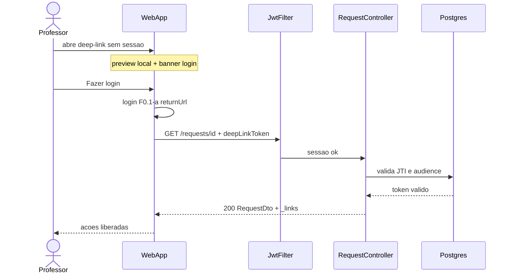

# F3.4-D03 — Deep-link por e-mail (sem sessão)

| Campo | Valor |
|---|---|
| HU | US-F3-003 |
| Escopo | preview → login → validar token → ações liberadas |
| Atores | Professor, WebApp, JwtFilter, RequestController, Postgres |
| Pré-condições | URL com `token=JWT` 1-uso (`audience=request-action`, TTL 7d); sem sessão |
| Origem | `docs/tcc-docs.md` §8.4 · CA-04 · RN-F3.4-05 |

## Passos

1. Professor abre o link do e-mail sem estar logado.
2. WebApp monta preview local (sem chamada autenticada) + banner “Faça login…”.
3. Login com `returnUrl` preservada (fluxo F0.1-a).
4. Após login: GET com Bearer + validação do deep-link (audience, sub, exp, JTI).
5. Token válido **não** é blacklistado ainda — só na TX da deliberação (F3.4-D02).

## Mermaid

## Export

[`F3.4-D03-deeplink-sem-sessao.puml`](./F3.4-D03-deeplink-sem-sessao.puml)
