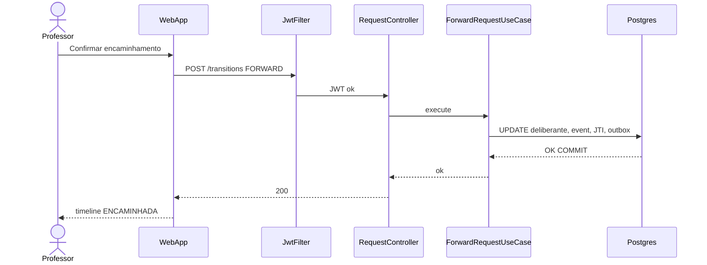

# F3.4-D04 — Encaminhar para outro professor

| Campo | Valor |
|---|---|
| HU | US-F3-003 |
| Escopo | FORWARD + JWT 1-uso + outbox para o destino |
| Atores | Professor, WebApp, JwtFilter, RequestController, ForwardRequestUseCase, Postgres |
| Pré-condições | `request.deliberate`; `_links.encaminhar`; destinatário selecionado |
| Origem | `docs/tcc-docs.md` §8.4 · CA-06 |

## Passos

1. Professor confirma encaminhamento.
2. TX: UPDATE deliberante + `request_event` + gera/grava JTI do novo deep-link + `outbox_event` (`solicitacoes.assigned_to_user`).
3. Dispatcher envia e-mail com URL `.../deliberar?token={jwt}` ao destino.
4. Originador perde `canDeliberate` após o FORWARD.

## Mermaid

## Export

[`F3.4-D04-encaminhar-professor.puml`](./F3.4-D04-encaminhar-professor.puml)
