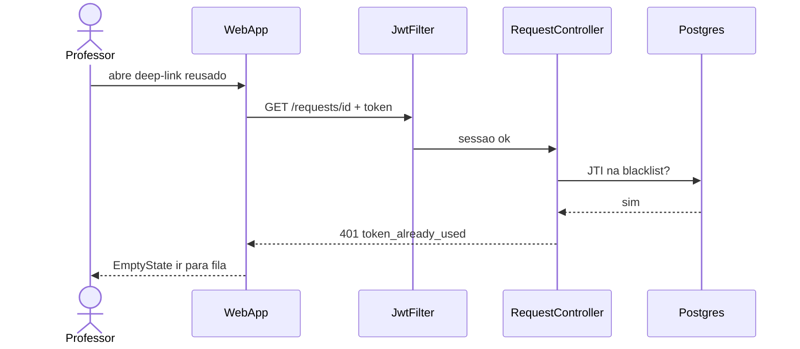

# F3.4-ERRO-a — Deep-link com token já utilizado

| Campo | Valor |
|---|---|
| HU | US-F3-003 |
| Escopo | JTI na blacklist → `401 token_already_used` |
| Atores | Professor, WebApp, JwtFilter, RequestController, Postgres |
| Pré-condições | sessão válida; deep-link com JTI já consumido |
| Origem | `docs/tcc-docs.md` §8.4 · CA-05 · RN-F3.4-05 |

## Passos

1. Professor abre deep-link cujo JTI já foi usado na deliberação.
2. Controller consulta blacklist → `401` (token inválido, não 403 de authority).
3. UI: EmptyState “Este link já foi utilizado…” + CTA para a fila (`F3.3-D01`).

## Mermaid

## Export

[`F3.4-ERRO-a-token-ja-utilizado.puml`](./F3.4-ERRO-a-token-ja-utilizado.puml)
