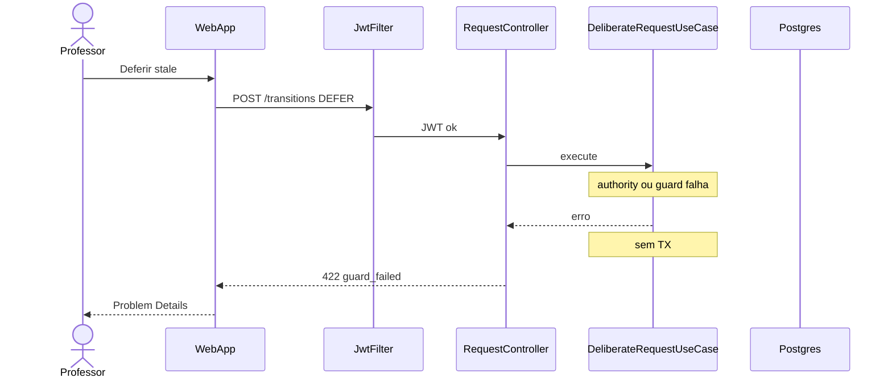

# F3.4-ERRO-b — Transição com guard inválido

| Campo | Valor |
|---|---|
| HU | US-F3-003 |
| Escopo | authority granular ausente ou guard do workflow → `422` |
| Atores | Professor, WebApp, JwtFilter, RequestController, DeliberateRequestUseCase, Postgres |
| Pré-condições | autenticado; `request.deliberate` ok, mas granular (ex. `.tcc`) ou guard falha |
| Origem | `docs/tcc-docs.md` §8.4 · RN-F3.4-05 |

## Passos

1. POST de transição (UI stale ou chamada direta — HATEOAS normalmente não expõe `_links.deferir`).
2. UseCase valida → falha; **sem** TX.
3. `422` Problem Details com `detail` do motivo (`guard_failed` / authority).

## Mermaid

## Export

[`F3.4-ERRO-b-guard-invalido.puml`](./F3.4-ERRO-b-guard-invalido.puml)
