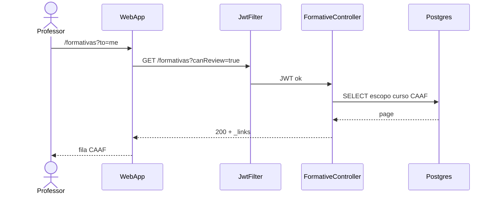

# F3.5-D01 — Fila de revisão CAAF

| Campo | Valor |
|---|---|
| HU | US-F3-004 |
| Escopo | `GET /formativas?canReview=true` — escopo de curso |
| Atores | Professor, WebApp, JwtFilter, FormativeController, Postgres |
| Pré-condições | `formative.review`; vínculo CAAF do curso |
| Origem | `docs/tcc-docs.md` §8.4 · CA-01 · RN-F3.5-02 |

## Passos

1. Professor abre `/formativas?to=me`.
2. Use case filtra pelo curso da CAAF (sem claim `cursoIds`).
3. `_links.batch-approve` só se houver itens `EVENTO_INTERNO_PRESENCA_VALIDADA`.

## Mermaid

## Export

[`F3.5-D01-fila-caaf.puml`](./F3.5-D01-fila-caaf.puml)
