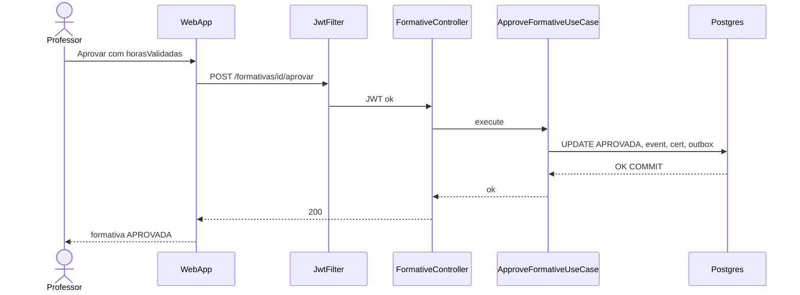

# F3.5-D02 — Aprovar formativa individual

| Campo | Valor |
|---|---|
| HU | US-F3-004 |
| Escopo | `POST /formativas/{id}/aprovar` + TX + certificado |
| Atores | Professor, WebApp, JwtFilter, FormativeController, ApproveFormativeUseCase, Postgres |
| Pré-condições | `formative.review`; `_links.aprovar`; estado elegível |
| Origem | `docs/tcc-docs.md` §8.4 · CA-02 · RN-F3.5-06 |

## Passos

1. Professor informa `horasValidadas` e aprova.
2. TX: UPDATE `APROVADA` + `event_log` + certificado + `outbox_event`.
3. Aluno notificado (in-app + e-mail); certificado usa horas validadas.

## Mermaid

## Export

[`F3.5-D02-aprovar-formativa.puml`](./F3.5-D02-aprovar-formativa.puml)
