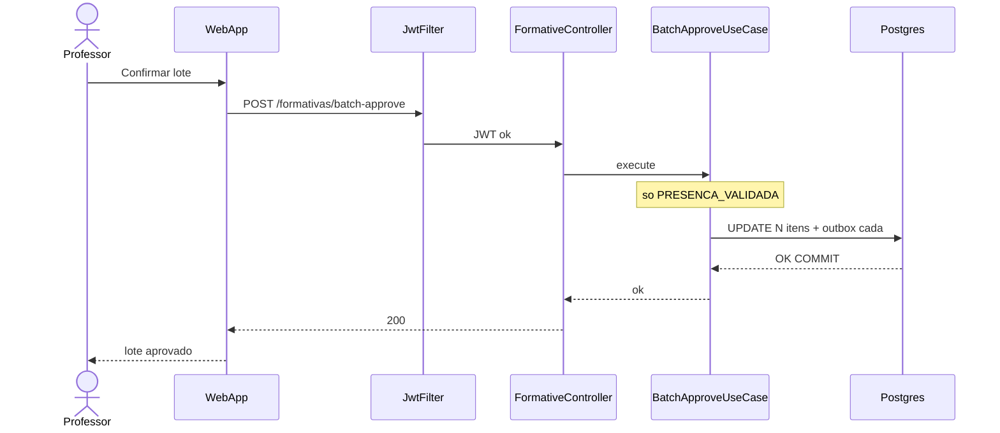

# F3.5-D03 — Aprovar formativas em lote

| Campo | Valor |
|---|---|
| HU | US-F3-004 |
| Escopo | batch só `EVENTO_INTERNO_PRESENCA_VALIDADA` |
| Atores | Professor, WebApp, JwtFilter, FormativeController, BatchApproveUseCase, Postgres |
| Pré-condições | `formative.review`; `_links.batch-approve`; itens com presença validada |
| Origem | `docs/tcc-docs.md` §8.4 · CA-03 · RN-F3.5-03 |

## Passos

1. Professor confirma lote no modal.
2. UseCase filtra tipo/estado; inválidos são excluídos sem abortar o batch.
3. Cada item: UPDATE + `event_log` + `outbox_event` próprio (certificado por aluno).

## Mermaid

## Export

[`F3.5-D03-aprovar-lote.puml`](./F3.5-D03-aprovar-lote.puml)
