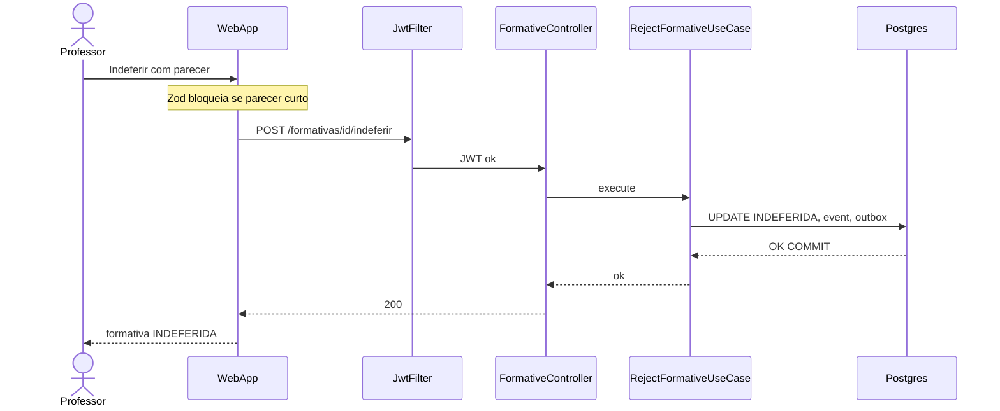

# F3.5-D04 — Rejeitar formativa com parecer

| Campo | Valor |
|---|---|
| HU | US-F3-004 |
| Escopo | `POST /formativas/{id}/indeferir` + TX + outbox |
| Atores | Professor, WebApp, JwtFilter, FormativeController, RejectFormativeUseCase, Postgres |
| Pré-condições | `formative.review`; `_links.rejeitar`; parecer ≥ 20 chars (client) |
| Origem | `docs/tcc-docs.md` §8.4 · CA-04 · RN-F3.5-05 |

## Passos

1. Parecer &lt; 20 chars → bloqueio no frontend (sem HTTP).
2. Parecer OK → TX: estado `INDEFERIDA` + `event_log` + `outbox_event` (`formativas.rejected`).
3. Aluno pode corrigir e resubmeter.

## Mermaid

## Export

[`F3.5-D04-rejeitar-formativa.puml`](./F3.5-D04-rejeitar-formativa.puml)
