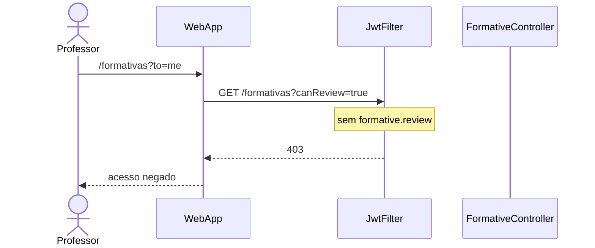

# F3.5-ERRO — 403 sem formative.review

| Campo | Valor |
|---|---|
| HU | US-F3-004 |
| Escopo | acesso à revisão CAAF sem capability |
| Atores | Professor, WebApp, JwtFilter, FormativeController |
| Pré-condições | autenticado; `formative.review` ausente |
| Origem | `docs/tcc-docs.md` §8.4 · RN-F3.5-01 |

## Passos

1. Navegação direta à URL (menu normalmente oculto via BFF/HATEOAS).
2. JwtFilter / controller → `403`.

## Mermaid

## Export

[`F3.5-ERRO-sem-formative-review.puml`](./F3.5-ERRO-sem-formative-review.puml)
