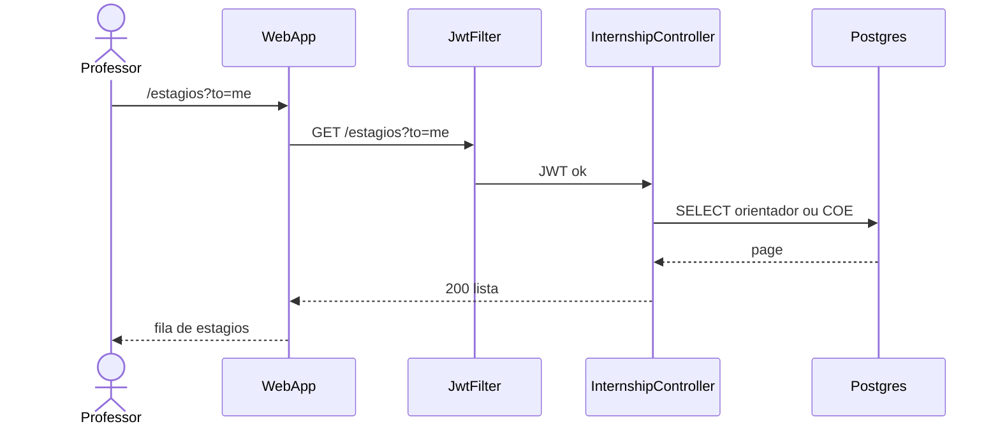

# F3.6-D01 — Listar estágios para revisão

| Campo | Valor |
|---|---|
| HU | US-F3-005 |
| Escopo | `GET /estagios?to=me` — orientador ou COE |
| Atores | Professor, WebApp, JwtFilter, InternshipController, Postgres |
| Pré-condições | `internship.review`; vínculo orientador ou COE |
| Origem | `docs/tcc-docs.md` §8.4 · CA-01 · RN-F3.6-01 |

## Passos

1. Professor abre `/estagios?to=me`.
2. Backend filtra por `orientadorId` ou vínculo COE do curso.
3. `documentoPendente` = tipo mais recente em `AGUARDANDO_PARECER`.

## Mermaid

## Export

[`F3.6-D01-listar-estagios.puml`](./F3.6-D01-listar-estagios.puml)
