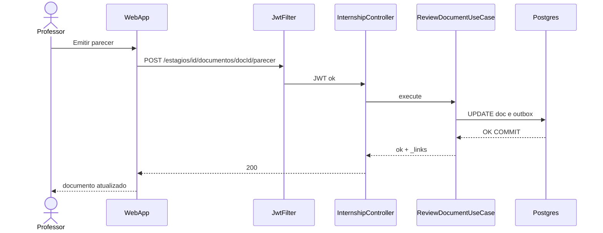

# F3.6-D02 — Emitir parecer em documento

| Campo | Valor |
|---|---|
| HU | US-F3-005 |
| Escopo | `POST .../parecer` + TX + outbox |
| Atores | Professor, WebApp, JwtFilter, InternshipController, ReviewDocumentUseCase, Postgres |
| Pré-condições | `internship.review`; `_links.revisar`; parecer preenchido |
| Origem | `docs/tcc-docs.md` §8.4 · CA-02 · RN-F3.6-03 |

## Passos

1. Professor envia parecer (APROVADO/REPROVADO).
2. TX: UPDATE documento + `outbox_event` (`estagios.document_reviewed`).
3. Resposta pode incluir `_links.arquivar` se todos os obrigatórios estiverem APROVADO.

## Mermaid

## Export

[`F3.6-D02-parecer-documento.puml`](./F3.6-D02-parecer-documento.puml)
