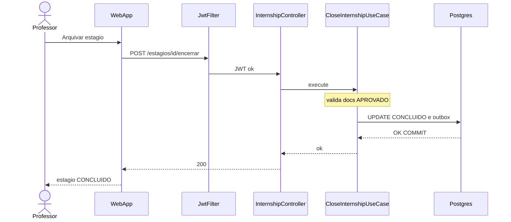

# F3.6-D03 — Arquivar estágio concluído

| Campo | Valor |
|---|---|
| HU | US-F3-005 |
| Escopo | `POST /estagios/{id}/encerrar` → CONCLUIDO + outbox |
| Atores | Professor, WebApp, JwtFilter, InternshipController, CloseInternshipUseCase, Postgres |
| Pré-condições | `internship.review`; `_links.arquivar` (obrigatórios APROVADO) |
| Origem | `docs/tcc-docs.md` §8.4 · CA-03 · RN-F3.6-05 |

## Passos

1. Professor confirma arquivamento.
2. UseCase revalida documentos; pendente → `422 documents_pending`.
3. TX: estado `CONCLUIDO` + `outbox_event` (`estagios.closed`).

## Mermaid

## Export

[`F3.6-D03-arquivar-estagio.puml`](./F3.6-D03-arquivar-estagio.puml)
