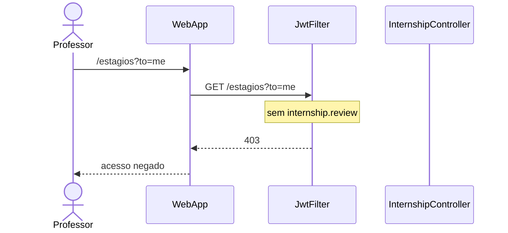

# F3.6-ERRO — 403 sem internship.review

| Campo | Valor |
|---|---|
| HU | US-F3-005 |
| Escopo | acesso à revisão de estágios sem capability |
| Atores | Professor, WebApp, JwtFilter, InternshipController |
| Pré-condições | autenticado; `internship.review` ausente |
| Origem | `docs/tcc-docs.md` §8.4 · RN-F3.6-01 |

## Passos

1. Navegação direta (menu normalmente oculto).
2. JwtFilter / controller → `403`.

## Mermaid

## Export

[`F3.6-ERRO-sem-internship-review.puml`](./F3.6-ERRO-sem-internship-review.puml)
