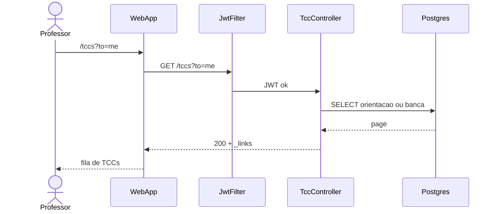

# F3.7-D01 — Listar TCCs para avaliação

| Campo | Valor |
|---|---|
| HU | US-F3-006 |
| Escopo | `GET /tccs?to=me` — orientador / banca |
| Atores | Professor, WebApp, JwtFilter, TccController, Postgres |
| Pré-condições | `tcc.supervise`; vínculo orientação ou banca |
| Origem | `docs/tcc-docs.md` §8.4 · CA-01 · RN-F3.7-01 |

## Passos

1. Professor abre `/tccs?to=me`.
2. Backend filtra por orientador/co-orientador/banca.
3. `_links.avaliar` por item quando arquivo final enviado e estado permite.

## Mermaid

## Export

[`F3.7-D01-listar-tccs.puml`](./F3.7-D01-listar-tccs.puml)
