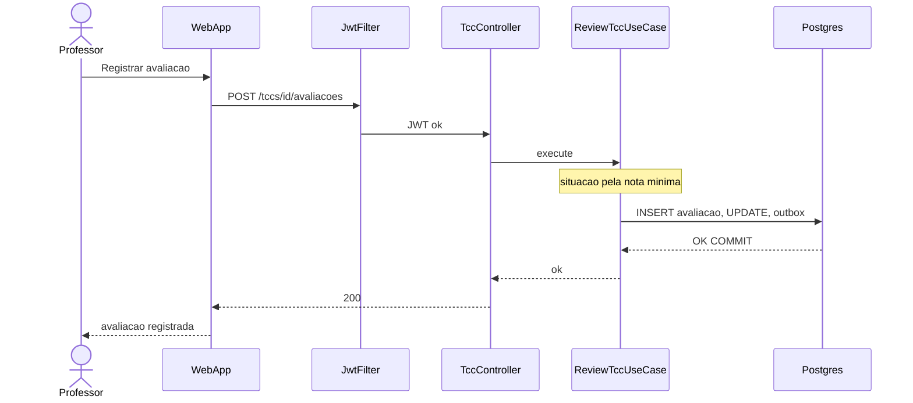

# F3.7-D02 — Registrar avaliação de TCC

| Campo | Valor |
|---|---|
| HU | US-F3-006 |
| Escopo | `POST /tccs/{id}/avaliacoes` + TX + outbox |
| Atores | Professor, WebApp, JwtFilter, TccController, ReviewTccUseCase, Postgres |
| Pré-condições | `tcc.supervise`; `_links.avaliar`; arquivo final enviado |
| Origem | `docs/tcc-docs.md` §8.4 · CA-02 · RN-F3.7-04 |

## Passos

1. Professor envia nota + parecer (sem `situacao` no payload).
2. UseCase calcula situação (`APROVADO` / `COM_CORRECOES` / `REPROVADO`) pela nota mínima.
3. TX: INSERT `tcc_evaluation` imutável + UPDATE TCC + `outbox_event` (`tcc.reviewed`).

## Mermaid

## Export

[`F3.7-D02-registrar-avaliacao.puml`](./F3.7-D02-registrar-avaliacao.puml)
