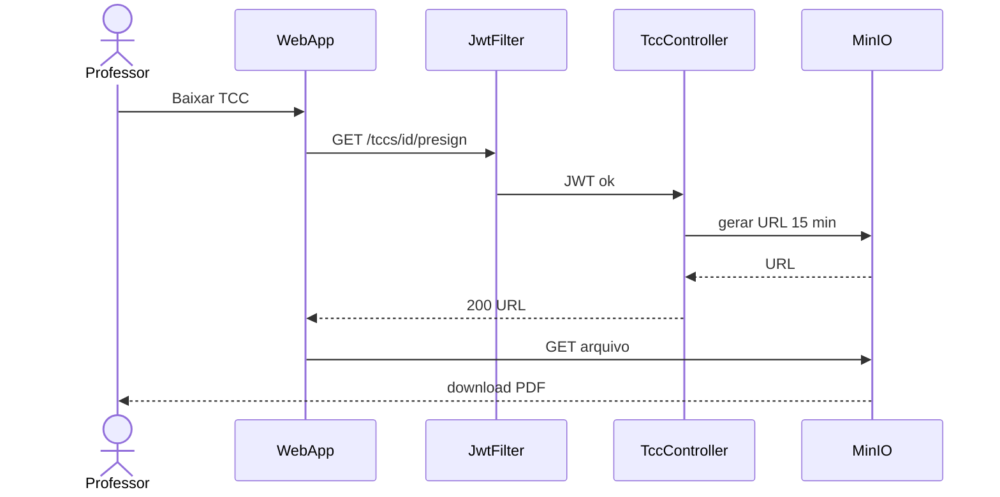

# F3.7-D03 — Download do arquivo TCC

| Campo | Valor |
|---|---|
| HU | US-F3-006 |
| Escopo | URL pré-assinada MinIO (15 min) |
| Atores | Professor, WebApp, JwtFilter, TccController, MinIO |
| Pré-condições | `tcc.supervise`; `_links.download`; arquivo final existe |
| Origem | `docs/tcc-docs.md` §8.4 · CA-03 · RN-F3.7-03 |

## Passos

1. Professor clica Baixar TCC.
2. Backend gera URL pré-assinada (TTL 15 min).
3. Navegador baixa direto do MinIO (arquivo não trafega pelo backend).

## Mermaid

## Export

[`F3.7-D03-download-tcc.puml`](./F3.7-D03-download-tcc.puml)
