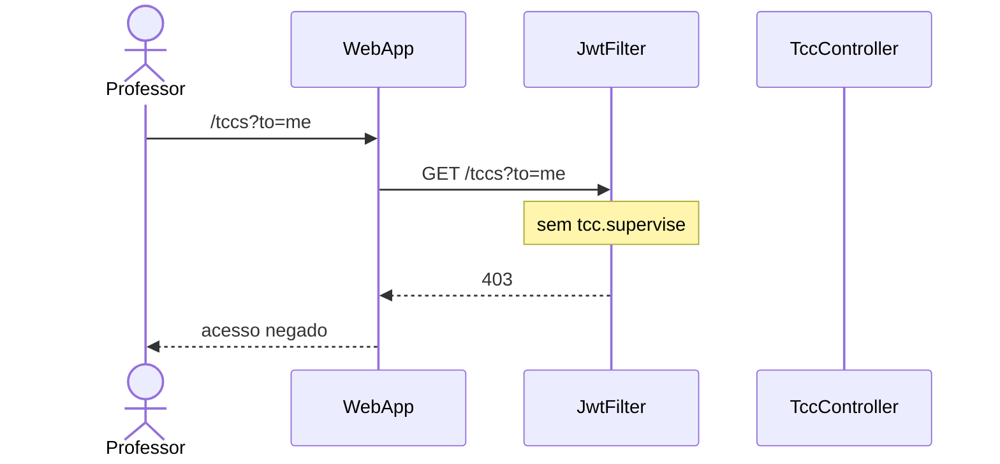

# F3.7-ERRO — 403 sem tcc.supervise

| Campo | Valor |
|---|---|
| HU | US-F3-006 |
| Escopo | acesso à fila de TCC sem capability |
| Atores | Professor, WebApp, JwtFilter, TccController |
| Pré-condições | autenticado; `tcc.supervise` ausente |
| Origem | `docs/tcc-docs.md` §8.4 · RN-F3.7 |

## Passos

1. Navegação direta (menu normalmente oculto).
2. JwtFilter / controller → `403`.

## Mermaid

## Export

[`F3.7-ERRO-sem-tcc-supervise.puml`](./F3.7-ERRO-sem-tcc-supervise.puml)
