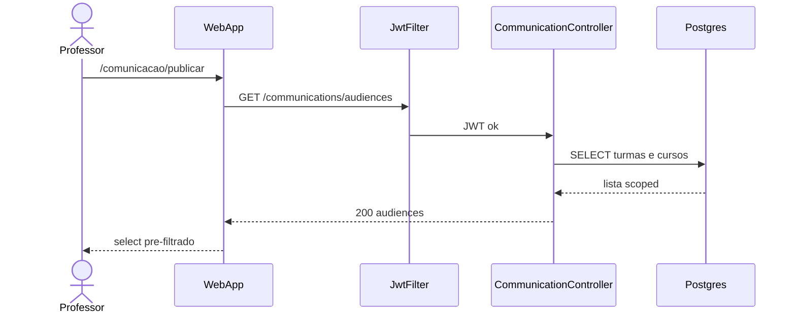

# F3.8-D01 — Carregar opções de audiência

| Campo | Valor |
|---|---|
| HU | US-F3-007 |
| Escopo | select só com turmas/cursos do professor |
| Atores | Professor, WebApp, JwtFilter, CommunicationController, Postgres |
| Pré-condições | `communication.publish_class` |
| Origem | `docs/tcc-docs.md` §8.4 · CA-04 · RN-F3.8-01 |

## Passos

1. Professor abre `/comunicacao/publicar`.
2. Backend retorna apenas turmas/cursos vinculados.
3. Opção “todos da universidade” exige `system.broadcast` — não vem na lista.

## Mermaid

## Export

[`F3.8-D01-opcoes-audiencia.puml`](./F3.8-D01-opcoes-audiencia.puml)
