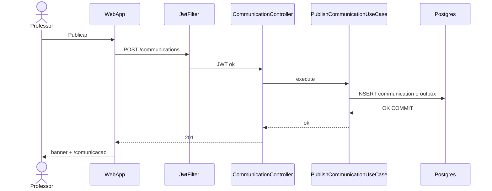

# F3.8-D02 — Publicar comunicado

| Campo | Valor |
|---|---|
| HU | US-F3-007 |
| Escopo | `POST /communications` + TX + outbox fan-out |
| Atores | Professor, WebApp, JwtFilter, CommunicationController, PublishCommunicationUseCase, Postgres |
| Pré-condições | `communication.publish_class`; audiência no scope |
| Origem | `docs/tcc-docs.md` §8.4 · CA-02 · RN-F3.8-02 |

## Passos

1. Professor publica título, corpo Markdown, audiência, prioridade e `expiraEm`.
2. TX: INSERT communication + `outbox_event` (`comunicacao.published`).
3. Dispatcher faz fan-out por destinatário conforme prioridade; redirect para `/comunicacao`.

## Mermaid

## Export

[`F3.8-D02-publicar-comunicado.puml`](./F3.8-D02-publicar-comunicado.puml)
