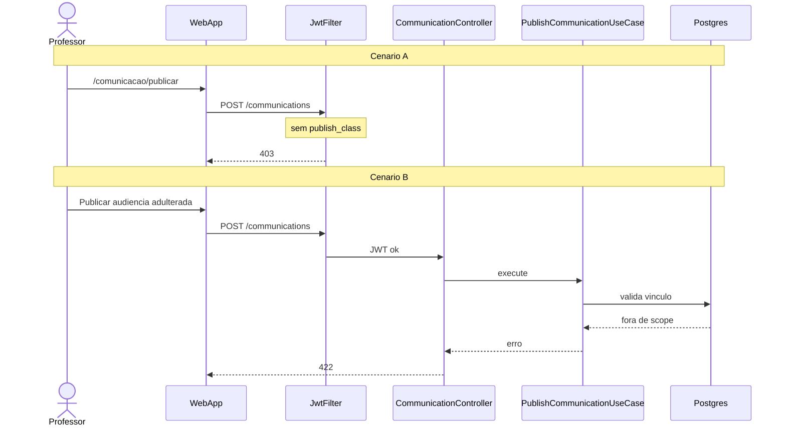

# F3.8-ERRO — 403 FGAC / 422 audiência fora de scope

| Campo | Valor |
|---|---|
| HU | US-F3-007 |
| Escopo | Cenário A: sem `communication.publish_class` · B: audiência adulterada |
| Atores | Professor, WebApp, JwtFilter, CommunicationController, PublishCommunicationUseCase, Postgres |
| Pré-condições | A: capability ausente · B: `audienciaId` fora do vínculo |
| Origem | `docs/tcc-docs.md` §8.4 · RN-F3.8-01 |

## Passos

1. **A:** POST/GET sem capability → `403` (defesa de URL direta).
2. **B:** UseCase revalida vínculo professor↔audiência na TX → `422`.

## Mermaid

## Export

[`F3.8-ERRO-publish-scope.puml`](./F3.8-ERRO-publish-scope.puml)
