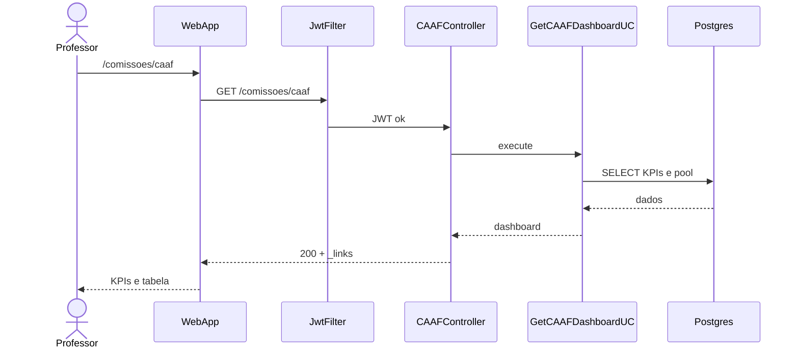

# F4.1a — Carregar pool CAAF

| Campo | Valor |
|---|---|
| HU | US-F4-001 |
| Escopo | KPIs + pool (não atribuídas + atribuídas a mim) |
| Atores | Professor, WebApp, JwtFilter, CAAFController, GetCAAFDashboardUC, Postgres |
| Pré-condições | `formative.review`; vínculo CAAF ativa; ≥ 1 formativa no pool |
| Origem | `docs/tcc-docs.md` §8.5 · CA-01 · RN-F4.1-09 |

## Passos

1. Professor abre `/comissoes/caaf`.
2. Query: estado NOT IN (`APROVADA`,`REJEITADA`); escopo via `commission_member.curso_id`.
3. Badges: `assignee` null → “No pool”; `assignee = userId` → “Comigo”.
4. `_links.assign-member` só se sem responsável ou responsável = eu.

## Mermaid

## Export

[`F4.1a-carregar-pool-caaf.puml`](./F4.1a-carregar-pool-caaf.puml)
